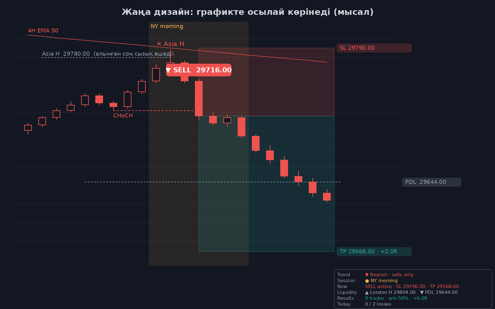
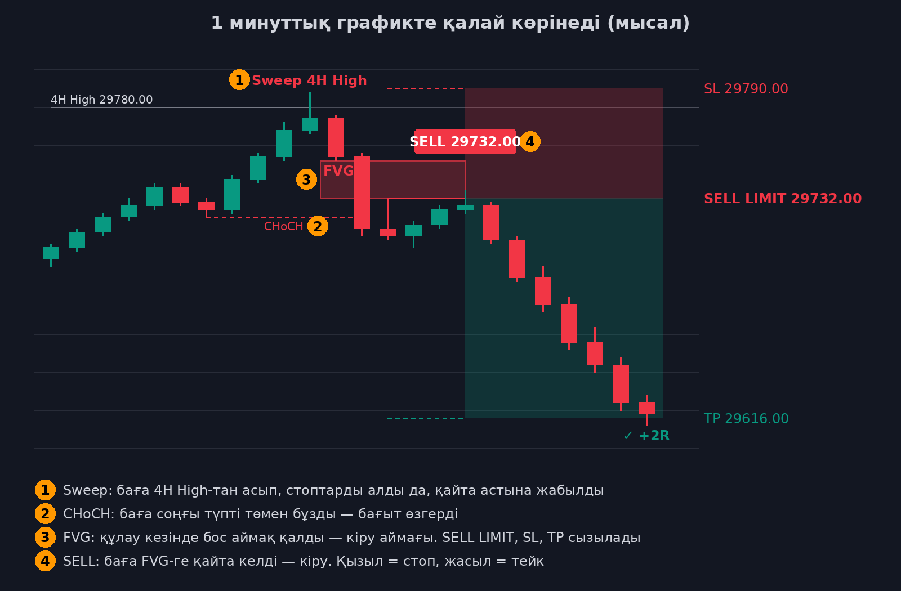

# Order Flow Sweep (TradingView, тегін аккаунт)

[`order-flow-sweep.pine`](order-flow-sweep.pine) — графиктің **астындағы бөлек панельде** тұратын orderflow индикаторы.
Ол liquidity sweep болған кезде orderflow-дың (delta, көлем, CVD) оны растайтын-растамайтынын көрсетеді.
Панельдегі мәндердің бәрі гистограмма, сондықтан график жылжығанда ештеңе орнынан қозғалмайды.

> ⚠️ **Бұл шамамен есептелген orderflow.** Нақты tick-by-tick orderflow (footprint) TradingView-та тек
> Premium жазылымда `request.footprint()` арқылы қолжетімді. Мұнда delta былай есептеледі:
> **5м графикте** әр 5м шамның ішіндегі 1м шамдардан (бұл дәлірек), ал **1м графикте** шамның жабылған орнынан (бұл өрескелдеу).
> Сондықтан бұл панельді **5м графикте** қолданыңыз, ал entry-ді 1м-де FVG арқылы алыңыз.

| Панельде | Мағынасы |
|---|---|
| Жасыл / қызыл бағандар | Әр шамның delta-сы: алушылар көп болса жасыл, сатушылар көп болса қызыл. **Ашық түсті баған — ірі ойыншы** (көлем орташадан 2 есе көп). |
| **✕ 4H High** (қызыл) | 4H/1H High алынды **және** orderflow оны растайды → SELL-ді күтесіз. |
| **· 4H High** (сұр) | Деңгей алынды, бірақ orderflow растамайды → **кірмейсіз**. |
| **SELL · SL 29813.50** | Sweep-тен кейін сатушылар бақылауды алды: delta-сы қатты теріс шам sweep шамының түбін бұзды. Стоп бағасы жазылған. |
| **BUY · SL ...** | Жоғарыдағының айнадағы көрінісі (Low sweep-тен кейін). |

**Sweep кезінде тексерілетін 3 orderflow белгісі** (әдепкі бойынша 3-тің 2-еуі керек):

1. **Trapped traders** — High-та delta оң болды, яғни алушылар бағаны итерді, бірақ шам қайта астына жабылды. Сонда алушылар тұзаққа түседі.
2. **🐋 Ірі ойыншы** — көлем орташадан 2 есе көп.
3. **CVD divergence** — баға жаңа шыңға шықты, бірақ CVD шықпады.

Тінтуірді **✕** белгісінің үстіне апарсаңыз, 3 белгінің қайсысы орындалғаны көрінеді.

**Қолдану реті:** 5м графикке қосасыз → **✕** шықса, дайындаласыз → **SELL/BUY** шықса, 1м-ге өтіп, FVG-ден кіресіз, стопты панельде жазылған бағаға қоясыз.

---

# Sweep CHoCH FVG Entry (TradingView)

**Графикте не көрінеді:**

- **Тренд:** шамдар тренд бойынша боялады (жасыл — тек BUY, қызыл — тек SELL), ал 4H EMA 50 сызығы графикте тұрады.
- **Ликвидтілік:** жіңішке нүктелі сызықтар, оң жағында `Asia H  29780.00`, `PDL  29644.00` сияқты жазулар. Деңгей алынған кезде сызығы өшеді, ал алынған жерде `✕ Asia H` белгісі қалады.
- **Сигнал:** `▼ SELL 29716.00` немесе `▲ BUY ...` белгісі. Қасында позиция аймағы тұрады (қызыл — стоп, жасыл — тейк), шетінде `SL ...` және `TP ... · +2.0R` бағалары жазылады.
- **NY таңғы сессиясы** (09:30–11:00) жеңіл сары түспен белгіленеді.
- **Панель** (оң төменгі бұрыш):

| Жол | Мағынасы |
|---|---|
| Trend | `▲ Bullish · buys only` немесе `▼ Bearish · sells only` |
| Session | `● NY morning`, `NY afternoon`, `Outside NY · wait` |
| **Now** | **Қазір не істеу керек:** `Wait for a liquidity sweep` → `✕ Asia H swept · wait CHoCH (below 29705.25)` → `SELL active · SL … · TP …` |
| Liquidity | Ең жақын деңгейлер: ▲ жоғарыда, ▼ төменде |
| Results | Осы графиктегі нәтиже |
| Today | Бүгінгі ұтылыс саны (2/2 болса ⛔ стоп) |

**Research** кестесі (12 нұсқаны салыстыру) әдепкі бойынша өшірулі. ⚙️ → Display бөлімінен қосасыз.

NQ1!, MNQ1!, ES1!, MES1! фьючерстеріне арналған индикатор. Ол **Liquidity sweep → CHoCH → FVG**
стратегиясын қадам-қадаммен тексеріп, барлық шарт орындалғанда ғана нақты **SELL / BUY** береді.
Индикатордың өзі ағылшынша, ал бұл нұсқаулық қазақша.

> ⚠️ Бұл шешім қабылдауға көмектесетін құрал. Графиктегі өткен нәтижелер болашақтағы табысқа кепілдік бермейді.

## 🔬 Research кестесі: қай нұсқа шынымен жұмыс істейді

Графиктің оң жағында (ортасында) кесте шығады. Индикатор стратегияның **12 нұсқасын** графиктің бүкіл тарихында
**бір мезгілде** тексереді:

- **Entry**: Confirmation немесе FVG limit;
- **Trend**: сүзгісіз, 1H EMA 50 немесе 4H EMA 50;
- **NY hours**: 09:30–16:00 немесе тек таңғы сессия 09:30–11:00.

Әр нұсқаның нәтижесі тарихтың **1-жартысы** мен **2-жартысында** бөлек көрсетіледі. Бір жартыда ғана пайда берген нұсқа
кездейсоқ болуы мүмкін. **★** белгісі **екі жартыда да пайда берген**, жалпы R-і ең жоғары нұсқаның жанында тұрады.

**Қалай қолдану керек:** ★ белгіленген жолдағы баптауларды ⚙️-ге қоясыз (**Entry type**, **Trend filter**, **Only trade inside**).
Сауда саны аз болса (1м графикте ~3,5 күн ғана тарих бар), 5м немесе 15м графикте де қарап, нәтижелерді салыстырыңыз.

## Стратегия қалай тексеріледі

| Қадам | Индикатор не істейді |
|---|---|
| **1 · Liquidity** | Ірі ойыншылар NY сессиясында алатын деңгейлерді сызады: **Asia High/Low**, **London High/Low**, кешегі күннің High/Low (**PD High/Low**), сонымен бірге 4H және 1H графиктеріндегі соңғы swing High/Low. Деңгейдің аты High/Low болған шамның жанында тұрады. Бір бағада екі деңгей болса, маңыздырағының аты жазылады (PD > London > Asia > 4H > 1H). |
| **2 · Sweep** | Сіз қарап отырған графикте (1м/5м) баға осы деңгейден асып кетіп, стоптарды алады да, қайта ішке жабылады. Графикте `Sweep 4H High` деген жазу шығады. Көлем үлкен болса, жанына 🐋 қосылады. |
| **3 · CHoCH** | Баға қарсы бағыттағы соңғы swing-ті бұзады, графикте `CHoCH` сызығы пайда болады. |
| **4 · FVG** | Сол қозғалыста FVG пайда болады. Ол түсті FVG қорабымен белгіленеді. Қасында үш сызық пайда болады, әрқайсысында бағасы жазылған: `SELL LIMIT 29732.00` (кіру), `SL 29790.00` (стоп), `TP 29616.00` (тейк). Ордерді осы бағалармен қоясыз. |
| **5 · Entry** | Баға FVG-ге қайта келгенде **SELL 29732.00** немесе **BUY ...** белгісі шығады. Қызыл қорап — стоп, жасыл қорап — тейк. |

Шарттың біреуі орындалмаса, белгі **шықпайды**. Ереже бойынша кіруге болмайтын жерде сұр **NO TRADE** белгісі шығады. Себебін көру үшін тінтуірді үстіне апарыңыз:

- `Stop too big` — стоп тым үлкен.
- `R:R ... below` — тейкке дейінгі қашықтық тым жақын.
- `Outside the trading window` — сауда уақытынан тыс.

**Ереже қарапайым:** графикте **SELL LIMIT / BUY LIMIT** сызықтары жоқ болса, кірмейсіз.

## Неге енді ештеңе жылжымайды

- Барлық есептеу **шам жабылғанда ғана** жасалады. Шам қалыптасып жатқанда белгілер пайда болып-жоғалмайды.
- Әр сызық пен жазу **бір рет** сызылады және орнынан қозғалмайды.
- Ескерту: 1м графикте сол жаққа қатты жылжытсаңыз, TradingView ескі деректерді қосымша жүктеп, индикаторды басынан қайта есептейді. Сонда ескі тарихтағы белгілер сәл өзгеруі мүмкін. Бұл TradingView-тың өз ерекшелігі. Соңғы, яғни қазіргі белгілерге бұл әсер етпейді.

## Сіздің әдісіңізбен қалай пайдалану керек

1. **4H, 1H, 30м, 15м**: бағытты өзіңіз анықтайсыз, бұрынғыдай. Индикатор 4H/1H деңгейлерін өзі сызып береді.
2. **5м немесе 1м**: индикаторды осы графикке қосасыз. Ол sweep, CHoCH, FVG табылғанын тексеріп, entry береді.
3. ⚙️ → **Trade direction** баптауын өзіңіздің 4H/1H бағытыңызға қойыңыз. Мысалы, bearish болсаңыз `Sell only` таңдайсыз. Сонда графикте тек SELL сетаптары қалады.

## Орнату

1. TradingView → оң жақ панельдегі **Pine Editor** (шырша белгісі).
2. Ескі кодты түгел өшіріп (⌘ Cmd+A → Delete), [`sweep-choch-fvg.pine`](sweep-choch-fvg.pine) ішіндегі кодты қойыңыз.
3. **Сохранить** → **Добавить на график**. Ескі индикаторларды графиктен алып тастаңыз.
4. Таймфрейм: **1м немесе 5м**, толық (ETH) сессиямен.

## Негізгі баптаулар (⚙️)

| Баптау | Әдепкі мәні | Не өзгертеді |
|---|---|---|
| **Entry type** | **Confirmation** | **Confirmation**: sweep-тен кейін CHoCH болған шам жабылғанда, сол шамның өзінде **BUY / SELL** шығады (кіру — шамның жабылу бағасы). **FVG limit**: FVG-ге қайта келуді күтеді (бұрынғы әдіс). |
| Trend filter | 4H EMA 50 | SELL тек баға 4H EMA 50-ден төмен болғанда, BUY тек жоғары болғанда шығады. Тренд бағытына қарсы сетаптар ең көп ұтылатын еді. |
| Only trade inside | қосулы, `0930-1600` | Тек NY сессиясында кіресіз. Тек таңғы сессия керек болса, `0930-1100` қойыңыз. |
| News pause | өшірулі, `1345-1500` | Жаңалық уақытында жаңа entry шықпайды. ФРС күні `1345-1500`, CPI/NFP күні `0825-0900` қойыңыз (NY уақыты). |
| Stop for the day after N losses | 2 | Бір күнде 2 рет ұтылсаңыз, индикатор сол күні жаңа сигнал бермейді, ал нәтиже кестесінде ⛔ шығады. Күн 18:00 NY-да жаңарады. |
| Max bars waiting for the retrace | 12 | Limit 12 шам ішінде толмаса, күшін жояды. Баға 1R кетіп қалса немесе қарсы жақтың ликвидтілігін алып үлгерсе, бұрынырақ жояды. Бұл кеш кіруден сақтайды. |
| Move stop to breakeven at +1R | қосулы | Баға +1R-ға жеткенде стоп кіру бағасына жылжиды (нәтижесі `BE 0R`). |
| Require a strong CHoCH candle | өшірулі | Қоссаңыз, CHoCH шамының денесі орташадан 1,5 есе үлкен болуы керек (displacement). |
| Show results on this chart | қосулы | Оң төменгі бұрышта осы графиктегі нәтиже шығады: сауда саны, winrate, BE, ұтылыс, жалпы R және бүгінгі ұтылыс саны. |
| Timeframe A / B | 4H / 1H | Ликвидтілік алынатын таймфреймдер |
| Trade direction | Both | `Buy only` немесе `Sell only` — 4H/1H бағытыңызға қарсы сетаптарды жасырады |
| Entry | FVG edge | FVG-нің шетінен кіру. `FVG 50%` таңдасаңыз, ортасынан кіресіз (бағасы жақсырақ, бірақ кейде толмай қалады) |
| Stop buffer | 4 tick | Sweep ұшынан қанша tick әрі стоп қойылатыны |
| Target | Fixed R:R = 2 | `Opposite liquidity` таңдасаңыз, тейк қарсы жақтағы ең жақын 4H/1H деңгейге қойылады |
| Max stop size | 0 (өшірулі) | Мысалы, 30 қойсаңыз, стопы 30 пункттен үлкен сетап **NO TRADE** болады |

## Alert

**Alert → SCF Entry → Any alert() function call** таңдасаңыз, хабарлама нақты бағалармен келеді. Мысалы:
`MNQ1! SELL LIMIT 29790.00 | SL 29813.50 | TP 29743.00 | after 4H High sweep`.
